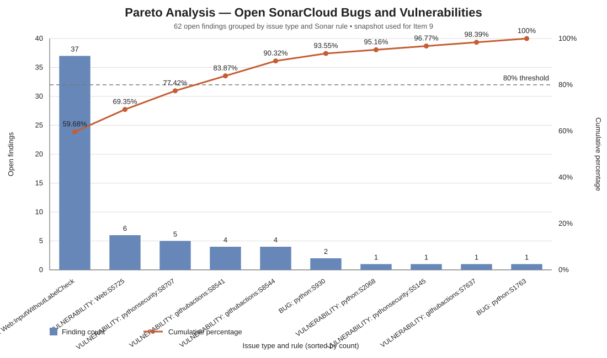

# Pareto analysis — open SonarCloud findings

**Snapshot:** SonarCloud `main` branch, captured 27 November 2026  
**Scope:** 62 currently open findings: 40 bugs and 22 vulnerabilities.  
**Grouping:** issue type + Sonar rule, sorted by count.

## Results

| Type | Rule | Open findings | Cumulative |
|---|---|---:|---:|
| BUG | `Web:InputWithoutLabelCheck` | 37 | 59.68% |
| VULNERABILITY | `Web:S5725` | 6 | 69.35% |
| VULNERABILITY | `pythonsecurity:S8707` | 5 | 77.42% |
| VULNERABILITY | `githubactions:S8541` | 4 | 83.87% |
| VULNERABILITY | `githubactions:S8544` | 4 | 90.32% |
| BUG | `python:S930` | 2 | 93.55% |
| VULNERABILITY | `python:S2068` | 1 | 95.16% |
| VULNERABILITY | `pythonsecurity:S5145` | 1 | 96.77% |
| VULNERABILITY | `githubactions:S7637` | 1 | 98.39% |
| BUG | `python:S1763` | 1 | 100.00% |

The largest group is `BUG / Web:InputWithoutLabelCheck` with 37 of 62 findings (59.68%). The first five groups account for 56 findings (90.32%); the cumulative line crosses the 80% reference after the fourth group (77.42%) and the fifth group (83.87%). This indicates that the findings are concentrated in a small number of rule groups, particularly the input-label accessibility rule.

## Interpretation and limitations

- This is a prioritisation view of the captured open SonarCloud findings, not a measure of exploitability or business impact.
- The counts are grouped by rule and issue type. Multiple findings under one rule may have different causes and severities.
- This chart is a snapshot; it should be regenerated after a new SonarCloud analysis.
- It is not the same as the project defect register and should not be used to infer that all 62 findings are independently confirmed runtime defects.

## Suggested action

Prioritise reviewing the 37 `Web:InputWithoutLabelCheck` findings as a batch, then triage the vulnerability rule groups individually by severity, affected file, and reachability. Record each remediation and verify it with a fresh SonarCloud scan.
